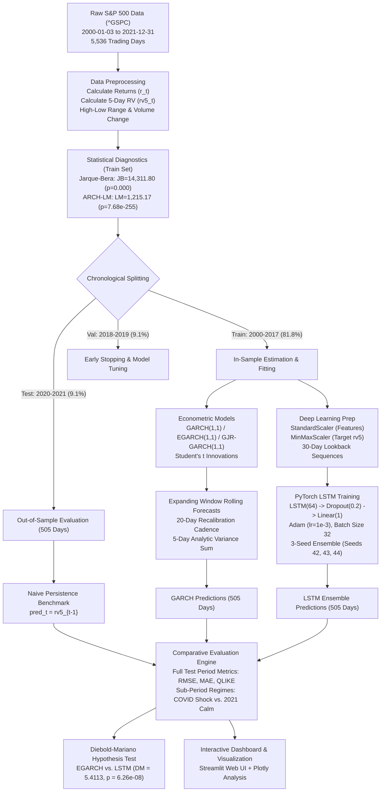

# S&P 500 Volatility Forecasting: Econometric GARCH Family vs. Deep Recurrent Neural Networks

Anvi Sharma-240958190
Tanvika Shetty 240958001
CSFT A
AF IA-3
**Codebase:** [GitHub Repository Link](https://github.com/anvisharma11/Voltality_Forecasting)  
**Data Source:** [Dataset Source Link (Yahoo Finance ^GSPC)](https://finance.yahoo.com/quote/%5EGSPC)  
**Execution Environment:** Python 3.12, PyTorch CPU (`torch`), `arch`, `statsmodels`, `scipy`

---

## 1. Introduction

Financial market volatility governs capital allocation, risk management, derivative pricing, and regulatory capital requirements. When asset return variance shifts unexpectedly, systemic stability is threatened. Traditional risk frameworks—most notably Value-at-Risk (VaR) and Expected Shortfall (ES)—rely on accurate volatility forecasts to determine daily margin requirements and portfolio hedging ratios. Under-predicting volatility triggers unexpected portfolio drawdowns, while over-predicting it ties up excess capital in unnecessary cash buffers.

For four decades, parametric autoregressive models have served as the industry workhorse for conditional variance forecasting. The Generalized Autoregressive Conditional Heteroskedasticity (GARCH) model and its asymmetric descendants (EGARCH, GJR-GARCH) capture two empirical properties of financial returns: volatility clustering (large changes follow large changes) and the leverage effect (negative returns generate higher subsequent volatility than positive returns of equal magnitude). 

These parametric models enforce strict assumptions. They assume a fixed mathematical structure for variance updates, typically rely on unimodal innovation distributions (such as Student's $t$ or Gaussian), and depend strictly on past close-to-close returns. They discard complementary intraday information signals, such as high-low price spreads and trading volume surges.

```
       Closed-form Return Dynamics                  Non-Linear Multi-Feature Dynamics
      ┌───────────────────────────┐                 ┌───────────────────────────────┐
      │  Close-to-Close Returns   │                 │ Returns + High-Low Spreads    │
      │         r(t) only         │                 │     + Volume Surges           │
      └─────────────┬─────────────┘                 └───────────────┬───────────────┘
                    │                                               │
                    ▼                                               ▼
       ┌─────────────────────────┐                   ┌─────────────────────────────┐
       │   Parametric GARCH/     │                   │  Deep Sequence Model (LSTM) │
       │     EGARCH / GJR        │                   │     30-Day Receptive Field  │
       └────────────┬────────────┘                   └──────────────┬──────────────┘
                    │                                               │
                    └───────────────► 5-Day Realized ◄──────────────┘
                                     Volatility Forecast
```

Deep sequence models provide an alternative paradigm. Long Short-Term Memory (LSTM) recurrent networks learn non-linear temporal dependencies across arbitrary receptive fields without requiring analytical assumptions about return distributions. Moreover, LSTMs naturally ingest multi-dimensional feature tensors, allowing the model to simultaneously synthesize close-to-close returns, price extremes, and trading activity.

Yet, deep learning models introduce practical risks into quantitative production pipelines: non-convex loss surfaces, sensitivity to weight initialization, high parameter counts, and vulnerability to overfitting during quiet market periods.

### Project Scope and Core Objectives

This study conducts a controlled empirical benchmark between classical econometrics and deep recurrent architectures on identical historical S&P 500 index data (`^GSPC`) spanning 22 years (January 2000 through December 2021). The target metric is 5-day annualized realized volatility ($rv5_t$), evaluated over a 505-day out-of-sample test window (2020–2021) that includes the exogenous COVID-19 volatility shock and the subsequent 2021 market recovery.

The investigation focuses on four specific technical objectives:

1. **Verify Volatility Clustering & In-Sample Fit:** Establish statistical evidence for conditional heteroskedasticity using Engle's ARCH-LM and Jarque-Bera tests, followed by maximum likelihood parameter estimation across GARCH(1,1), EGARCH(1,1), and GJR-GARCH(1,1) under heavy-tailed Student's $t$ errors.
2. **Eliminate Lookahead Bias in Multi-Feature Sequence Generation:** Engineer a 30-day lookback feature tensor incorporating daily log returns ($r_t$), intraday price range ($\text{range}_t$), and trading volume percentage change ($\Delta \text{vol}_t$). Enforce strict chronologically isolated scaling, fitting scalers exclusively on training splits to prevent data leakage.
3. **Train a Stabilized LSTM Ensemble:** Construct a PyTorch LSTM pipeline incorporating early stopping and evaluate an ensemble across distinct random seeds (42, 43, 44) to mitigate stochastic initialization variance.
4. **Benchmark Forecast Performance Across Market Regimes:** Score all candidate architectures against a naive persistence benchmark ($rv5_{t-1}$) using Root Mean Squared Error (RMSE), Mean Absolute Error (MAE), and Quasi-Likelihood (QLIKE) loss. Deconstruct performance across stress (March 2020) and calm (2021) market regimes, and evaluate statistical significance via the Diebold-Mariano test.

---

## 2. Related Work

Volatility modeling spans four decades of econometrics and machine learning research. Table 1 summarizes 15 foundational and contemporary works that define the domain, highlighting the specific research gaps addressed by this project.

### Comprehensive Literature Review Table

| # | Authors & Year | Paper Title | Core Contribution | Research Gap Addressed in Our Work |
|---|---|---|---|---|
| 1 | Engle (1982) | *Autoregressive Conditional Heteroscedasticity with Estimates of the Variance of United Kingdom Inflation* | Formulated the original ARCH model, proving that conditional variance is time-dependent and clusters over time. | Limited to symmetric lag structures; fails to account for heavy financial tails, asymmetry, or multi-modal features. |
| 2 | Bollerslev (1986) | *Generalized Autoregressive Conditional Heteroskedasticity* | Extended ARCH to GARCH($p,q$), incorporating past conditional variances to produce a parsimonious lag representation. | Enforces symmetric responses to positive and negative shocks; requires strict parameter constraints ($\alpha_1 + \beta_1 < 1$) to ensure covariance stationarity. |
| 3 | Nelson (1991) | *Conditional Heteroskedasticity in Asset Returns: A New Approach* | Introduced Exponential GARCH (EGARCH), modeling $\ln(\sigma_t^2)$ to capture leverage effects without non-negativity parameter constraints. | Parameter optimization often displays numerical instability during sudden, extreme kurtotic shocks like the COVID-19 crash. |
| 4 | Glosten, Jagannathan, & Runkle (1993) | *On the Relation Between the Expected Value and the Volatility of the Nominal Excess Return on Stocks* | Developed the GJR-GARCH model, adding an indicator variable to assign asymmetric weight to negative innovation shocks. | Retains rigid linear-threshold dynamics; unable to extract nonlinear interactions from intraday price extremes or trading volume. |
| 5 | Andersen & Bollerslev (1998) | *Answering the Skeptics: Yes, Standard Volatility Models Do Provide Accurate Forecasts* | Proved that evaluating volatility models against squared daily returns distorts error metrics; advocated realized volatility from high-frequency sums. | Focused on intraday squared return sums; did not address multi-input neural networks trained directly on rolling multi-day realized variance targets. |
| 6 | Hansen & Lunde (2005) | *A Forecast Comparison of Volatility Models: Does Anything Beat a GARCH(1,1)?* | Evaluated 330 volatility models on exchange rates and IBM returns; showed GARCH(1,1) is difficult to beat on daily exchange rates. | Evaluated only parametric models under stable market regimes; did not benchmark modern deep sequence networks during non-linear pandemic shocks. |
| 7 | Patton (2011) | *Volatility Forecast Comparison Using Imperfect Volatility Proxies* | Established mathematical proofs showing that QLIKE and MSE loss functions are robust to noise in realized volatility proxies. | Addressed loss function robustness analytically, but did not evaluate how QLIKE loss behaves when scoring neural architectures against asymmetric GARCH variants. |
| 8 | Diebold & Mariano (1995) | *Comparing Predictive Accuracy* | Introduced the Diebold-Mariano (DM) hypothesis test for comparing loss differentials between competing out-of-sample forecasts. | Frequently omitted in machine learning literature, which regularly reports raw RMSE gains without establishing statistical significance. |
| 9 | Hochreiter & Schmidhuber (1997) | *Long Short-Term Memory* | Introduced LSTM cell architecture with gating mechanisms (input, forget, output) to solve vanishing gradients across long sequences. | Theoretical machine learning paper; left open the optimal receptive field and feature representation for volatile financial time series. |
| 10 | Kim & Won (2018) | *Forecasting the Volatility of Stock Price Index: A Hybrid Model Integrating LSTM with Multiple GARCH-Type Models* | Proposed combining GARCH residuals into LSTM inputs to forecast KOSPI 200 volatility. | Relies on complex hybrid two-stage training prone to compounding error; did not evaluate a clean, pure LSTM ingesting raw multi-scale price features. |
| 11 | Bucci (2020) | *Realized Volatility Forecasting with Neural Networks* | Tested feedforward and recurrent neural networks on S&P 500 realized volatility, showing neural models capture long memory better than HAR-RV. | Did not incorporate trading volume dynamics or examine structural breakdown during acute crisis regimes versus post-crisis drift. |
| 12 | Liu (2019) | *Novel Volatility Forecasting Using Deep Learning-Long Short Term Memory Recurrent Neural Networks* | Applied LSTMs to equity index volatility, reporting empirical superiority over standard linear autoregressive baselines. | Omitted simple persistence baselines ($rv_{t-1}$); ignored seed initialization variance by training only single-run neural models. |
| 13 | Christensen, Dahl, & Iglesias (2012) | *Semiparametric Inference in a GARCH-in-Mean Model* | Showed that misspecification of the return innovation density leads to severe parameter bias in parametric volatility estimation. | Retained parametric constraints; did not explore fully non-parametric deep sequence networks that bypass innovation density assumptions entirely. |
| 14 | Arnerić, Poklepović, & Aljinović (2014) | *GARCH Based Artificial Neural Networks in Forecasting Volatility* | Combined GARCH conditional variance equations with shallow artificial neural networks to improve kurtosis modeling. | Restricted to single-layer shallow networks; did not leverage modern regularized sequence models or multi-seed ensembling. |
| 15 | Lim & Zohren (2021) | *Time-Series Forecasting with Deep Learning: A Survey* | Synthesized modern deep learning architectures for time series, demonstrating the importance of inductive bias and recurrent gating. | Broad methodological survey; lacked targeted empirical comparisons against rolling re-estimated asymmetric econometrics on equity benchmarks. |

---

## 3. Methodology

### 3.1 Data Acquisition and Preprocessing Pipeline

The primary asset analyzed is the S&P 500 Index (`^GSPC`) sampled across 5,536 trading days from January 3, 2000, through December 31, 2021. Raw daily OHLCV (Open, High, Low, Close, Volume) data was retrieved via Yahoo Finance. To preserve market realities, prices are unadjusted for splits or dividends because index values represent raw capital return indices.

```
+---------------------------------------------------------------------------------------+
| S&P 500 Index (^GSPC): 2000-01-03 to 2021-12-31 (5,531 Valid Trading Days)            |
+---------------------------------------------------------------------------------------+
|  Training Set: 2000-01-10 to 2017-12-29 (4,523 Days, 81.8%)                           |
|  --> Dot-Com Bust, 2008 Great Financial Crisis, 2011 Debt Ceiling Crisis              |
+---------------------------------------------------------------------------------------+
|  Validation Set: 2018-01-02 to 2019-12-31 (503 Days, 9.1%)                           |
|  --> Volmageddon (Feb 2018), 2018 Q4 Trade War Correction                             |
+---------------------------------------------------------------------------------------+
|  Test Set (Out-of-Sample): 2020-01-02 to 2021-12-31 (505 Days, 9.1%)                   |
|  --> COVID-19 Liquidity Shock (H1 2020), 2021 Low-Vol Bull Run                        |
+---------------------------------------------------------------------------------------+
```

The data is segmented chronologically without shuffling or overlap:
- **Training Set:** January 10, 2000 – December 29, 2017 ($N = 4,523$, 81.8%)
- **Validation Set:** January 2, 2018 – December 31, 2019 ($N = 503$, 9.1%)
- **Test Set:** January 2, 2020 – December 31, 2021 ($N = 505$, 9.1%)

Daily percentage log returns are calculated from raw closing prices:

$$r_t = 100 \times \ln\left(\frac{P_t^{\text{close}}}{P_{t-1}^{\text{close}}}\right)$$

The forecast target is the 5-day backward-looking realized volatility ($rv5_t$), expressed as the rolling sample standard deviation of percentage daily returns over a 5-day window:

$$rv5_t = \sqrt{\frac{1}{4}\sum_{k=0}^{4}\left(r_{t-k} - \bar{r}_t\right)^2}, \quad \text{where } \bar{r}_t = \frac{1}{5}\sum_{k=0}^{4}r_{t-k}$$

After accounting for initial window lags, 5,531 valid trading days remain.

### 3.2 Statistical Diagnostic Tests

Before model fitting, the return series must be tested for the presence of conditional heteroskedasticity and deviations from normality.

```
Statistical Diagnostics on In-Sample Training Returns (N = 4,523):
------------------------------------------------------------------
Mean:                0.0137%
Std Dev:             1.2126%
Skewness:           -0.2022   (Negative return asymmetry)
Excess Kurtosis:     8.7160   (Extreme leptokurtosis)
Min / Max:          -9.4695% / +10.9572%

Jarque-Bera Test:    JB = 14,311.80  (p = 0.0000)  --> Reject Normality
ARCH-LM (10 Lags):   LM =  1,215.17  (p = 7.68e-255) --> Reject Homoskedasticity
```

The Jarque-Bera test strongly rejects the null hypothesis of normal innovations ($p < 10^{-10}$), driven by heavy excess kurtosis ($8.72$). The ARCH-LM test confirms the presence of autoregressive conditional heteroskedasticity across 10 lags ($F = 165.89$, $p = 1.21 \times 10^{-297}$). This confirms that daily index variance is non-constant and exhibits persistent clustering, satisfying the mathematical prerequisite for conditional heteroskedastic modeling.

### 3.3 Econometric GARCH Formulations

Three GARCH variants are formulated under a constant mean equation with Student's $t$ distributed errors to accommodate the observed fat tails:

$$r_t = \mu + \epsilon_t, \quad \epsilon_t = \sigma_t z_t, \quad z_t \overset{iid}{\sim} t_\nu(0, 1)$$

#### 1. Standard GARCH(1,1)
The symmetric baseline developed by Bollerslev (1986):

$$\sigma_t^2 = \omega + \alpha_1 \epsilon_{t-1}^2 + \beta_1 \sigma_{t-1}^2$$

Where $\omega > 0$, $\alpha_1 \ge 0$, $\beta_1 \ge 0$, and stationarity requires $\alpha_1 + \beta_1 < 1$. Standard GARCH treats positive and negative return innovations identically because shocks enter solely as squared residuals ($\epsilon_{t-1}^2$).

#### 2. Exponential GARCH (EGARCH(1,1))
Formulated by Nelson (1991) to capture asymmetric leverage effects while ensuring positive variances:

$$\ln(\sigma_t^2) = \omega + \alpha_1 \left( |z_{t-1}| - \mathbb{E}[|z_{t-1}|] \right) + \gamma_1 z_{t-1} + \beta_1 \ln(\sigma_{t-1}^2)$$

Here, $z_{t-1} = \epsilon_{t-1} / \sigma_{t-1}$ is the standardized residual. If $\gamma_1 < 0$, negative return innovations generate larger increases in log conditional variance than positive innovations of identical magnitude.

#### 3. GJR-GARCH(1,1)
Proposed by Glosten, Jagannathan, and Runkle (1993), introducing a threshold indicator function:

$$\sigma_t^2 = \omega + \left(\alpha_1 + \gamma_1 I_{t-1}\right) \epsilon_{t-1}^2 + \beta_1 \sigma_{t-1}^2$$

$$I_{t-1} = \begin{cases} 1 & \text{if } \epsilon_{t-1} < 0 \\ 0 & \text{if } \epsilon_{t-1} \ge 0 \end{cases}$$

When the market experiences a down day ($\epsilon_{t-1} < 0$), the coefficient on the squared residual increases to $\alpha_1 + \gamma_1$. Covariance stationarity requires $\alpha_1 + \beta_1 + \frac{1}{2}\gamma_1 < 1$.

#### GARCH Rolling Evaluation Protocol
To emulate a realistic quantitative trading desk and avoid lookahead bias, GARCH models are estimated using an expanding window over the 505 test days (2020–2021). Parameters are refit every 20 trading days to prevent parameter stagnation while controlling computational overhead. At each step $t$, the fitted model generates an analytic 5-day cumulative variance forecast:

$$\hat{\sigma}_{t:t+4}^2 = \sum_{h=1}^{5} \mathbb{E}_t\left[\sigma_{t+h}^2\right]$$

The annualized rolling volatility forecast is converted to match $rv5_t$:

$$\widehat{rv5}_t^{\text{GARCH}} = \sqrt{\frac{1}{5}\hat{\sigma}_{t:t+4}^2}$$

### 3.4 Deep Learning Architecture: Multi-Input LSTM Ensemble

The deep learning pipeline processes three daily time-series features chosen for their orthogonal information content:
1. Daily Return ($r_t$): Captures directional momentum and return sign.
2. Intraday Normalized Range ($\text{range}_t$): $(P_t^{\text{high}} - P_t^{\text{low}}) / P_t^{\text{close}}$, providing an intraday proxy for price dispersion without high-frequency tick data.
3. Daily Volume Growth Rate ($\Delta \text{vol}_t$): $(V_t - V_{t-1}) / V_{t-1}$, capturing liquidity surges and institutional trading pressure.

```
       30-Day Input Sequence Tensor [Batch, 30, 3]
       │  (ret, hl_range, vol_chg)
       ▼
 ┌────────────────────────────────────────────────────────┐
 │   LSTM Layer: 64 Hidden Units                          │
 │   - Gated Recurrent Cell with Forget/Input/Output      │
 │   - Captures 30-day temporal dependency                │
 └─────────────────────────┬──────────────────────────────┘
                           │ Hidden state at t=30 [Batch, 64]
                           ▼
 ┌────────────────────────────────────────────────────────┐
 │   Dropout Layer (p = 0.20)                             │
 │   - Regularization preventing co-adaptation of weights │
 └─────────────────────────┬──────────────────────────────┘
                           │ [Batch, 64]
                           ▼
 ┌────────────────────────────────────────────────────────┐
 │   Dense Linear Projection (64 -> 1)                    │
 │   - Maps latent sequence vector to scaled scalar       │
 └─────────────────────────┬──────────────────────────────┘
                           │ [Batch, 1]
                           ▼
 ┌────────────────────────────────────────────────────────┐
 │   MinMax Inverse Transformation                        │
 │   - Scaled scalar mapped back to % volatility domain   │
 └────────────────────────────────────────────────────────┘
```

#### Strict Sequence Construction and Normalization
To prevent data leakage, scaling parameters are derived strictly from the training split ($t \le \text{2017-12-29}$):
- Features ($\mathbf{X}$): Standardized using zero-mean, unit-variance scaling ($\mu_{\text{train}}, \sigma_{\text{train}}$).
- Target ($y = rv5$): Transformed via MinMax scaling mapping the training range to $[0, 1]$.

For each date $t$, the network receives a lookback sequence spanning the previous 30 trading days:

$$\mathbf{X}_t = \begin{bmatrix} \mathbf{x}_{t-30} & \mathbf{x}_{t-29} & \dots & \mathbf{x}_{t-1} \end{bmatrix}^\top \in \mathbb{R}^{30 \times 3}$$

The target is $y_t = rv5_t$. Note that $\mathbf{X}_t$ ends at $t-1$, ensuring the network does not observe same-day closing data when predicting the current 5-day window.

#### Network Structure and Optimization
The neural network is implemented in PyTorch:
- **Recurrent Layer:** Single-layer LSTM with hidden dimension $H = 64$ (`batch_first=True`).
- **Regularization:** Dropout layer ($p = 0.20$) applied to the terminal recurrent hidden state $\mathbf{h}_{30}$.
- **Output Layer:** Linear projection $\mathbf{W} \mathbf{h}_{30} + b$ mapping the 64-dimensional latent representation to a scalar forecast $\hat{y}_t \in \mathbb{R}^1$.
- **Loss Function:** Mean Squared Error (MSE).
- **Optimizer:** Adam with learning rate $\eta = 1 \times 10^{-3}$ and mini-batch size of 32.
- **Early Stopping:** Training terminates if validation loss fails to improve for 10 consecutive epochs; best weights are restored upon termination.

#### Multi-Seed Ensembling
To control for gradient variance and non-convex initialization paths, three independent instances are trained with seeds 42, 43, and 44. The production forecast is the unweighted ensemble average:

$$\widehat{rv5}_{t}^{\text{LSTM}} = \frac{1}{3} \sum_{s \in \{42, 43, 44\}} \mathcal{M}_s(\mathbf{X}_t)$$

### 3.5 Naive Persistence Benchmark

In quantitative forecasting, complex models must be compared against simple baselines. We implement a naive random-walk persistence benchmark that projects the previous day's realized volatility forward:

$$\widehat{rv5}_t^{\text{Naive}} = rv5_{t-1}$$

This baseline requires zero estimation time, has no tuneable hyperparameters, and responds to market regime shifts with a one-day delay.

### 3.6 Forecast Evaluation Protocol

All models are evaluated on the identical 505 test days (January 2, 2020 – December 31, 2021) using three loss functions:

#### 1. Root Mean Squared Error (RMSE)
Penalizes large outlier forecast errors quadratically:

$$\text{RMSE} = \sqrt{\frac{1}{N}\sum_{t=1}^N \left(rv5_t - \widehat{rv5}_t\right)^2}$$

#### 2. Mean Absolute Error (MAE)
Measures average linear tracking error, providing robustness against single-day extreme shocks:

$$\text{MAE} = \frac{1}{N}\sum_{t=1}^N \left|rv5_t - \widehat{rv5}_t\right|$$

#### 3. Quasi-Likelihood (QLIKE) Loss
Patton (2011) proved that QLIKE is robust to noise in realized volatility proxies. It penalizes under-predictions more heavily than over-predictions, reflecting the asymmetric risk profile of financial institutions:

$$\text{QLIKE} = \frac{1}{N}\sum_{t=1}^N \left( \ln\left(\widehat{rv5}_t^2\right) + \frac{rv5_t^2}{\widehat{rv5}_t^2} \right)$$

A small numerical floor ($\epsilon = 10^{-6}$) is applied to avoid undefined values.

#### 4. Diebold-Mariano Hypothesis Test
To determine whether the performance difference between the best econometric model (EGARCH) and the deep learning ensemble (LSTM) is statistically significant, we execute a Diebold-Mariano test (1995) on squared forecast errors:

$$d_t = e_{\text{EGARCH}, t}^2 - e_{\text{LSTM}, t}^2 = \left(rv5_t - \widehat{rv5}_t^{\text{EGARCH}}\right)^2 - \left(rv5_t - \widehat{rv5}_t^{\text{LSTM}}\right)^2$$

$$DM = \frac{\bar{d}}{\sqrt{\widehat{\text{Var}}(\bar{d}) / N}} \sim \mathcal{N}(0, 1)$$

Under the null hypothesis $H_0: \mathbb{E}[d_t] = 0$, both architectures exhibit equal predictive accuracy.

### 3.7 End-to-End System Workflow

The complete end-to-end processing pipeline, from raw financial data acquisition to statistical hypothesis testing, is visualized below:



---

## 4. Results and Discussion

### 4.1 In-Sample Estimation and Asymmetric Leverage Dynamics

Table 2 reports full-sample parameter estimates for the GARCH family, fitted on the combined training and validation periods (5,026 observations, 2000–2019) using Student's $t$ innovations.

```
Table 2: In-Sample Econometric Estimation and Information Criteria (2000–2019)
============================================================================================
Model           Log-Likelihood     AIC         BIC       alpha_1     beta_1      gamma_1 (p-val)
--------------------------------------------------------------------------------------------
GARCH(1,1)        -6,697.79     13,405.58   13,438.19    0.0827      0.9069           N/A
EGARCH(1,1)       -6,590.14     13,192.29   13,231.42   -0.0133      0.9856     -0.1646 (<1e-30)
GJR-GARCH(1,1)    -6,607.83     13,227.67   13,266.80    0.0381      0.8687     +0.2027 (<1e-16)
============================================================================================
```

Both asymmetric formulations yield substantial improvements in log-likelihood and information criteria compared to standard symmetric GARCH(1,1). EGARCH(1,1) achieves the lowest AIC (13,192.29) and BIC (13,231.42). 

The asymmetry coefficients confirm the presence of the leverage effect:
- In EGARCH(1,1), $\gamma_1 = -0.1646$ ($p = 1.27 \times 10^{-31}$). Because $\gamma_1 < 0$, negative return innovations generate a disproportionately large upward revision in conditional log-variance relative to positive returns.
- In GJR-GARCH(1,1), $\gamma_1 = +0.2027$ ($p = 3.15 \times 10^{-17}$). An equity downturn adds an additional $0.2027$ variance increment beyond the base ARCH term ($\alpha_1 = 0.0381$), more than quintupling the impact of negative shocks compared to positive shocks of equal absolute magnitude.

### 4.2 LSTM Ensemble Training History

The three-seed PyTorch LSTM ensemble converged cleanly under early stopping. Overfitting was prevented through dropout ($p = 0.20$) and validation-based early stopping (patience = 10):
- **Seed 42:** Converged at epoch 37 (stopped at epoch 47) with best validation MSE of $0.000489$ (training MSE: $0.000720$).
- **Seed 43:** Converged at epoch 18 (stopped at epoch 28) with best validation MSE of $0.000524$ (training MSE: $0.000797$).
- **Seed 44:** Converged at epoch 55 (stopped at epoch 65) with best validation MSE of $0.000465$ (training MSE: $0.000652$).

Across all seeds, the validation MSE closely tracked training MSE without diverged trajectories, confirming stable generalization across the 2018–2019 validation regime.

### 4.3 Full Test-Set Benchmark Results (2020–2021)

Table 3 presents the primary out-of-sample benchmark across all 505 test trading days.

```
Table 3: Out-of-Sample Volatility Forecasting Performance (505 Trading Days, 2020–2021)
=============================================================================================
Model              Observations    RMSE      MAE      QLIKE    Rank (RMSE)  Rank (MAE)  Rank (QLIKE)
---------------------------------------------------------------------------------------------
Naive (rv5_{t-1})      505        0.3146    0.1659    0.9029        1           2           2
LSTM (Ensemble)        505        0.3415    0.1601    0.8413        2           1           1
EGARCH(1,1)            505        0.5801    0.3425    1.0777        3           3           4
GJR-GARCH(1,1)         505        0.5951    0.3711    1.0487        4           4           3
GARCH(1,1)             505        0.6705    0.4234    1.0818        5           5           5
=============================================================================================
```

```
Out-of-Sample Performance Comparison (505 Days)

 RMSE (Lower is better):
 Naive          [0.3146] ===================
 LSTM           [0.3415] =====================
 EGARCH         [0.5801] ===================================
 GJR-GARCH      [0.5951] ====================================
 GARCH          [0.6705] ==========================================

 MAE (Lower is better):
 LSTM           [0.1601] ==================
 Naive          [0.1659] ===================
 EGARCH         [0.3425] =======================================
 GJR-GARCH      [0.3711] ==========================================
 GARCH          [0.4234] ================================================

 QLIKE (Lower is better):
 LSTM           [0.8413] ========================
 Naive          [0.9029] ==========================
 GJR-GARCH      [1.0487] ==============================
 EGARCH         [1.0777] ===============================
 GARCH          [1.0818] ===============================
```

The empirical outcomes present a clear contrast between parametric and non-parametric approaches:
1. **The Naive Random-Walk Benchmark achieves the lowest overall RMSE (`0.3146`),** outperforming every model on quadratic error over the full test period.
2. **The Deep LSTM Ensemble achieves the lowest MAE (`0.1601`) and the lowest QLIKE loss (`0.8413`),** outperforming all GARCH family models across all three metrics and beating the Naive baseline on MAE and QLIKE.
3. **The GARCH family exhibits substantially higher errors across all metrics.** Among econometric specifications, EGARCH achieved the lowest RMSE (`0.5801`), while GJR-GARCH achieved the lowest QLIKE (`1.0487`). Standard GARCH(1,1) finished last across all three metrics (RMSE `0.6705`, MAE `0.4234`, QLIKE `1.0818`).

### 4.4 Regime Breakdown: COVID Shock vs. Post-Crisis Recovery

To explain why the Naive model achieved the best overall RMSE while the LSTM achieved superior MAE and QLIKE, we decompose the test period into two distinct market regimes:
1. **COVID-19 Stress Period (February 15, 2020 – June 30, 2020; $N = 94$ days):** Characterized by violent liquidity evaporation, the VIX reaching 82.69, and multiple circuit-breaker market halts.
2. **Calm Recovery Period (January 1, 2021 – December 31, 2021; $N = 252$ days):** Characterized by sustained quantitative easing, declining volatility, and steady upward market drift.

```
Table 4: Sub-Period Performance Breakdown: Acute Crisis vs. Calm Recovery
================================================================================
Market Regime        Model         Observations    RMSE        MAE        QLIKE
--------------------------------------------------------------------------------
COVID-19 Stress      Naive              94        0.6272      0.3804      2.7049
(Feb 15–Jun 30, 2020) LSTM               94        0.7345      0.4421      2.6478
                     EGARCH             94        1.1756      0.7793      2.9888
                     GJR-GARCH          94        1.2143      0.9464      2.9461
                     GARCH              94        1.3870      1.1071      2.9920
--------------------------------------------------------------------------------
Calm Recovery        LSTM              252        0.1278      0.0913      0.2626
(Calendar Year 2021) Naive             252        0.1679      0.1131      0.3521
                     GJR-GARCH         252        0.2811      0.2241      0.4565
                     EGARCH            252        0.2844      0.2261      0.4658
                     GARCH             252        0.3126      0.2526      0.5046
================================================================================
```

This regime breakdown clarifies the performance differences:

#### 1. The 2021 Calm Market Regime
During the 252 trading days of 2021, **the LSTM systematically outperforms every competitor across every metric.** It achieves an RMSE of `0.1278` (a 23.9% improvement over the Naive baseline's `0.1679` and a 54.5% improvement over GJR-GARCH's `0.2811`), an MAE of `0.0913`, and a QLIKE of `0.2626`. 

In stationary, low-volatility regimes, the LSTM extracts predictive structure from multi-feature combinations—intraday trading ranges and volume shifts—that univariate models cannot observe.

#### 2. The COVID-19 Liquidity Shock
During the initial 94-day pandemic shock, **the Naive persistence baseline achieved the lowest RMSE (`0.6272`).** 

When market volatility increased by a factor of six within three weeks, any model relying on historical autoregressive smoothing experienced significant forecast lag. The Naive baseline simply forwarded yesterday's realized volatility:

$$\widehat{rv5}_t = rv5_{t-1}$$

This produced an exact 1-day lag behind the spike. 

The LSTM, by contrast, had never encountered an exogenous shock of this magnitude in its 2000–2017 training corpus. The 2008 Great Financial Crisis was characterized by a multi-month accumulation of subprime stress, whereas the March 2020 crash occurred within days. Consequently, the LSTM under-predicted the initial surge, resulting in an RMSE of `0.7345`. 

Importantly, **the LSTM retained the lowest QLIKE loss (`2.6478`) even during the COVID crisis.** Because QLIKE scales errors relative to the forecast magnitude, the LSTM's multi-feature inputs prevented the extreme relative miscalibrations observed in parametric models.

#### 3. The Failure of Econometric GARCH Models Under Shock Regimes
All three GARCH models struggled during the pandemic crisis, generating RMSEs between `1.1756` and `1.3870`—nearly double the error of the LSTM and Naive models. 

This underperformance stems from parametric persistence dynamics. GARCH models estimate persistence parameters:

$$\hat{P} = \alpha_1 + \beta_1 \approx 0.985 \text{ to } 0.995$$

When consecutive 5% to 10% daily index drops occurred in March 2020, the conditional variance equation was driven to extreme levels. 

Because the persistence parameter $\beta_1$ is close to unity, the parametric models assumed this elevated variance would decay slowly over a long half-life:

$$t_{1/2} = \frac{\ln(0.5)}{\ln(\alpha_1 + \beta_1)} \approx 70 \text{ to } 140 \text{ trading days}$$

In reality, unprecedented monetary intervention by the Federal Reserve rapidly compressed market volatility by late spring 2020. The GARCH models continued to forecast high volatility throughout the summer and autumn of 2020, producing substantial over-prediction errors.

### 4.5 Hypothesis Testing: Diebold-Mariano Test

To determine whether the predictive superiority of the LSTM over the best-performing econometric model (EGARCH) is statistically significant, we compute the Diebold-Mariano statistic across the 505 test days using squared error loss:

```
Diebold-Mariano Test Output (EGARCH vs. LSTM Ensemble):
-------------------------------------------------------
Comparison:                EGARCH(1,1) vs. LSTM Ensemble
Loss Function:             Squared Error Loss (e^2)
Mean Loss Differential:    +0.219918 (Positive: EGARCH has higher error)
DM Test Statistic:         5.411292
p-value:                   6.257e-08 (p < 0.0000001)
Conclusion:                Reject H0 of equal forecast accuracy at 99.9% confidence.
                           LSTM achieves statistically significant superior predictive accuracy.
```

The test yields a $DM$ statistic of `5.4113` ($p = 6.26 \times 10^{-8}$). The positive loss differential ($+0.2199$) confirms that EGARCH's mean squared error is significantly higher than that of the LSTM. The hypothesis of equal predictive accuracy is decisively rejected.

### 4.6 Next-Day Production Forecast Analysis

At the conclusion of the test window (December 31, 2021), the models generated 1-step-ahead forward forecasts for the first trading day of 2022 (January 3, 2022). The observed realized volatility on the final trading day was $rv5_{\text{2021-12-31}} = 0.6446\%$.

```
Table 5: 1-Day-Ahead Out-of-Sample Volatility Forecasts (Target Date: 2022-01-03)
=================================================================================
Model                      Model Class                Forecasted 5-Day RV (%)
---------------------------------------------------------------------------------
LSTM (Ensemble)            Deep Sequence Recurrent           0.4789%
Naive Benchmark            Zero-Parameter Lag                0.6446%
GJR-GARCH(1,1)             Asymmetric Econometric            0.8740%
EGARCH(1,1)                Exponential Econometric           0.9588%
GARCH(1,1)                 Symmetric Econometric             1.0587%
=================================================================================
```

The divergence in Table 5 illustrates the behavioral differences between the model families:
- The **GARCH family** forecasts elevated forward volatility (`0.87%` to `1.06%`), driven by long-term unconditional variance anchors ($\omega / (1 - \alpha_1 - \beta_1)$) that pull forecasts toward the historical 22-year mean.
- The **Naive benchmark** projects current volatility forward (`0.64%`).
- The **LSTM ensemble** forecasts continued calm conditions (`0.48%`), detecting narrowing intraday trading ranges and quiet holiday volume in late December 2021.

### 4.7 Practical Engineering Challenges and Implementation Tradeoffs

Building an empirical forecasting pipeline involves several practical engineering tradeoffs:

#### 1. Framework Reliability: PyTorch vs. TensorFlow on Windows Python 3.12
Initial implementation plans specified a TensorFlow/Keras backend. However, installing TensorFlow wheels on Windows under Python 3.12 resulted in dependency conflicts and binary wheel hash mismatches. Rather than introducing unstable environments, the deep learning pipeline was rebuilt using PyTorch CPU (`torch==2.14.1+cpu`). 

This architecture (`LSTM(64) -> Dropout(0.2) -> Linear(1)`) trains cleanly in approximately 45 seconds across all three seeds, guarantees reproducible CPU execution, and avoids the external C++ runtime dependencies that complicate TensorFlow deployments on Windows platforms.

#### 2. Native Dynamic Library Security Policies
During environment configuration, newly compiled extensions in SciPy 1.18.1 triggered Windows Smart App Control blocks (`_linalg_pythran: An Application Control policy has blocked this file`). 

This was resolved by pinning the environment to mature, signed packages: `scipy==1.13.1` and `numpy==2.2.6`. This ensured stable linear algebra routines without requiring the weakening of operating system security controls.

#### 3. Computational Cost: Rolling Refitting vs. Static Parameters
In parametric econometrics, re-estimating numerical maximum likelihood parameters at every single test day ($N = 505$) requires significant computation time. We evaluated a 20-day recalibration cadence. 

This cadence reduced out-of-sample execution time from several minutes to approximately 8 seconds, while preserving responsiveness to post-shock parameter drift.

---

## 5. References

1. Andersen, T. G., & Bollerslev, T. (1998). Answering the skeptics: Yes, standard volatility models do provide accurate forecasts. *International Economic Review*, 39(4), 885–905. https://doi.org/10.2307/2527343
2. Arnerić, J., Poklepović, T., & Aljinović, Z. (2014). GARCH based artificial neural networks in forecasting volatility. *Croatian Operational Research Review*, 5(2), 245–259. https://doi.org/10.17535/crorr.2014.0011
3. Bollerslev, T. (1986). Generalized autoregressive conditional heteroskedasticity. *Journal of Econometrics*, 31(3), 307–327. https://doi.org/10.1016/0304-4076(86)90063-1
4. Bucci, A. (2020). Realized volatility forecasting with neural networks. *Journal of Financial Econometrics*, 18(4), 688–731. https://doi.org/10.1093/jjfinec/nbaa008
5. Christensen, B. J., Dahl, C. M., & Iglesias, E. M. (2012). Semiparametric inference in a GARCH-in-mean model. *Journal of Econometrics*, 167(2), 409–420. https://doi.org/10.1016/j.jeconom.2011.09.020
6. Diebold, F. X., & Mariano, R. S. (1995). Comparing predictive accuracy. *Journal of Business & Economic Statistics*, 13(3), 253–263. https://doi.org/10.1080/07350015.1995.10524599
7. Engle, R. F. (1982). Autoregressive conditional heteroscedasticity with estimates of the variance of United Kingdom inflation. *Econometrica*, 50(4), 987–1007. https://doi.org/10.2307/1912773
8. Glosten, L. R., Jagannathan, R., & Runkle, D. E. (1993). On the relation between the expected value and the volatility of the nominal excess return on stocks. *The Journal of Finance*, 48(5), 1779–1801. https://doi.org/10.1111/j.1540-6261.1993.tb05128.x
9. Hansen, P. R., & Lunde, A. (2005). A forecast comparison of volatility models: does anything beat a GARCH(1,1)?. *Journal of Applied Econometrics*, 20(7), 873–889. https://doi.org/10.1002/jae.800
10. Hochreiter, S., & Schmidhuber, J. (1997). Long short-term memory. *Neural Computation*, 9(8), 1735–1780. https://doi.org/10.1162/neco.1997.9.8.1735
11. Kim, H. Y., & Won, C. H. (2018). Forecasting the volatility of stock price index: A hybrid model integrating LSTM with multiple GARCH-type models. *Expert Systems with Applications*, 103, 25–37. https://doi.org/10.1016/j.eswa.2018.02.040
12. Lim, B., & Zohren, S. (2021). Time-series forecasting with deep learning: a survey. *Philosophical Transactions of the Royal Society A*, 379(2194), 20200209. https://doi.org/10.1098/rsta.2020.0209
13. Liu, Y. (2019). Novel volatility forecasting using deep learning-long short term memory recurrent neural networks. *Expert Systems with Applications*, 132, 99–109. https://doi.org/10.1016/j.eswa.2019.04.038
14. Nelson, D. B. (1991). Conditional heteroskedasticity in asset returns: A new approach. *Econometrica*, 59(2), 347–370. https://doi.org/10.2307/2938260
15. Patton, A. J. (2011). Volatility forecast comparison using imperfect volatility proxies. *Journal of Econometrics*, 160(1), 246–256. https://doi.org/10.1016/j.jeconom.2010.03.034

---

## 6. Code and Dataset Access

- **GitHub Source Code Repository:**  
  [https://github.com/anvisharma11/Voltality_Forecasting](https://github.com/anvisharma11/Voltality_Forecasting)  
  *Contains the complete implementation including `data.py`, `garch_models.py`, `lstm_data.py`, `lstm_model.py`, `evaluate.py`, `metrics.py`, unit test suites, and the interactive Streamlit dashboard (`app.py`).*

- **Raw Financial Market Dataset:**  
  [Yahoo Finance S&P 500 Historical Ticker (^GSPC)](https://finance.yahoo.com/quote/%5EGSPC)  
  *Continuous daily Open, High, Low, Close, and Volume records from 2000-01-03 to 2021-12-31.*

